# 🥐 Golden Whisk Patisserie Assistant

**🔗 Live demo: [golden-whisk-assistant.streamlit.app](https://golden-whisk-assistant.streamlit.app)**

A RAG (Retrieval-Augmented Generation) chatbot for a **fictional** French-style patisserie in Texas.
Customers can ask about the menu, prices, custom cake orders, allergens, hours, pickup, catering,
and seasonal pre-orders. The assistant answers **only** from the shop's own documents and says
"I don't know" when the answer is not there.

The project goes end to end: knowledge base → RAG app → Docker image on Docker Hub →
Azure Kubernetes Service (AKS) created with Terraform → CI/CD with Jenkins (build and deploy pipelines) → online demo.

> **Note:** Golden Whisk Patisserie, its address, staff, menu, prices, and policies are invented
> for this portfolio project. Any resemblance to a real business is coincidental.

---

## ✨ Features

- **Answers grounded in documents** — 9 business documents (menu, allergens, custom cakes,
  hours, payments and refunds, storage, catering, FAQ) are split into chunks and stored in Pinecone.
- **Honest "I don't know"** — if the answer is not in the documents, the bot does not guess
  and points the customer to the shop's phone number or staff.
- **Allergen safety rule** — every answer about allergens or ingredients reminds the customer
  to confirm with a staff member, because all products are made in a shared kitchen.
- **Sources** — the app shows which document each answer came from.
- **Prompt-injection guard** — retrieved text is treated as untrusted data, not as instructions.
- **Observability** — every request is traced in **LangSmith** (retrieval step + LLM step, latency, inputs and outputs).
- **Always answers in English** — designed for US customers.
- **Containerized and automated** — Docker image, Kubernetes manifests with health probes,
  and two Jenkins pipelines (build → Docker Hub, deploy → Kubernetes).
- **Cloud infrastructure as code** — the Azure AKS cluster is created and destroyed with **Terraform**.

## 🧱 Architecture

### Application (RAG)

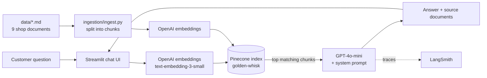

### CI/CD and deployment

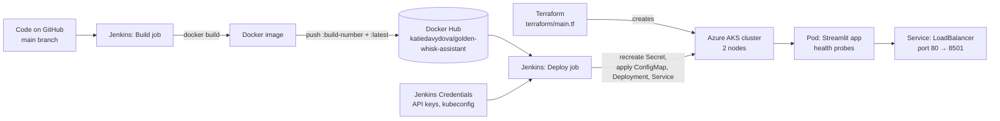

## 📸 Screenshots

**Live demo** — the app deployed on Streamlit Community Cloud:

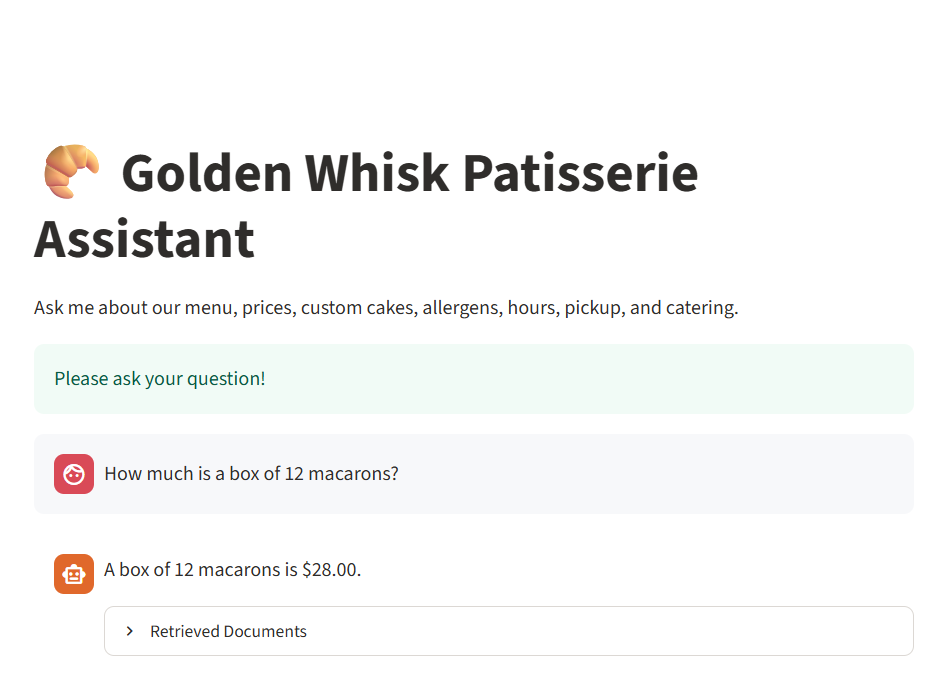

**Allergen question** — the answer comes from the allergen document and always adds a safety reminder:

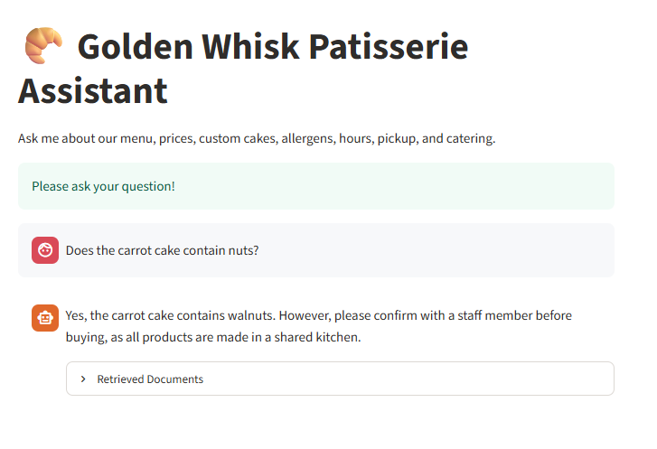

**Orders and prices** — precise answers from the custom cake and menu documents:

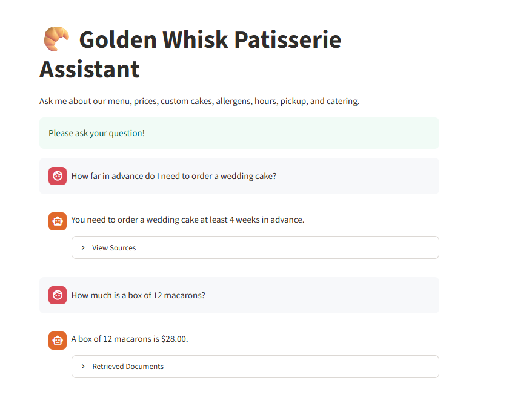

**Question not covered by the documents** — the bot does not guess:

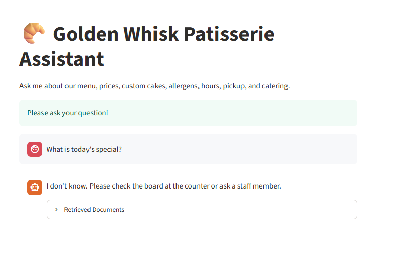

**LangSmith tracing** — each question is traced as a retrieval step and an LLM step:


**Jenkins** — build and deploy pipelines, both successful:

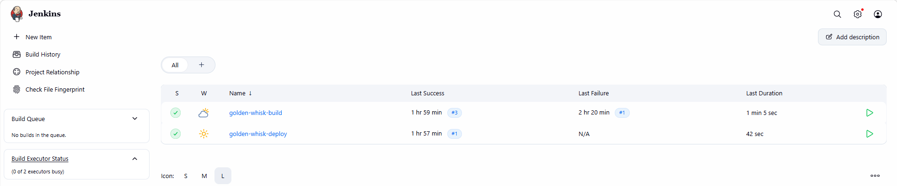

**Jenkins Build** — image built and pushed to Docker Hub with the build number and `latest` tags:

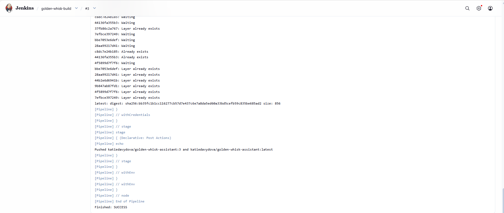

**Jenkins Deploy** — secret recreated from Jenkins credentials, manifests applied, rollout finished:

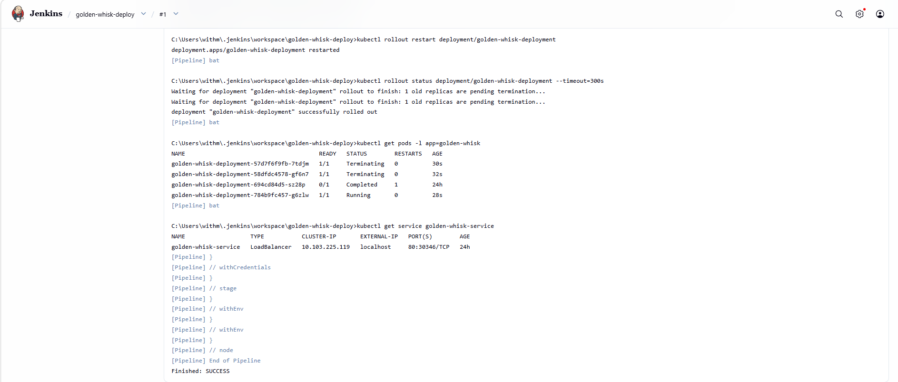

**Azure AKS** — the same image deployed by Jenkins to an AKS cluster created with Terraform, answering through a public IP:

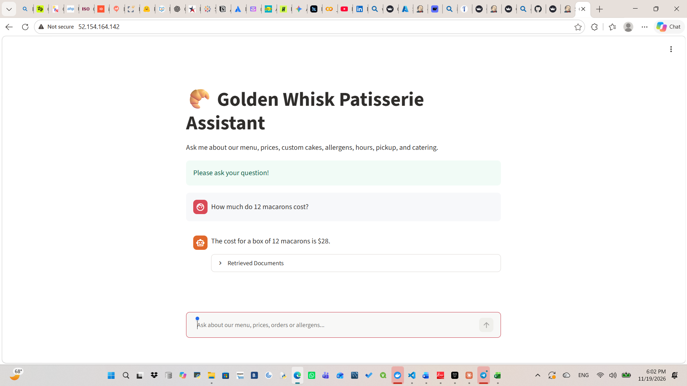

**Jenkins Deploy to AKS** — rollout finished and the LoadBalancer got an external IP:

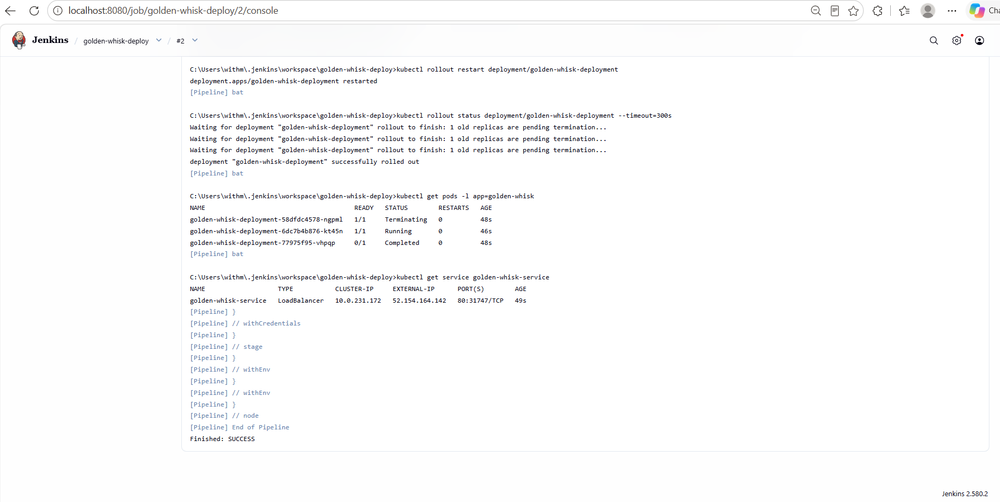

## 🛠 Tech Stack

| Area | Tools |
|---|---|
| Language | Python 3.12 |
| LLM framework | LangChain |
| LLM / embeddings | OpenAI `gpt-4o-mini`, `text-embedding-3-small` |
| Vector database | Pinecone (serverless, AWS us-east-1, 1536 dims, cosine) |
| UI | Streamlit |
| Observability | LangSmith |
| Containers | Docker, Docker Hub |
| Orchestration | Kubernetes (Deployment, Service, ConfigMap, Secret, health probes) |
| CI/CD | Jenkins (declarative pipelines, credentials) |
| Infrastructure as Code | Terraform (azurerm provider) |
| Cloud | Microsoft Azure: AKS (Free tier, 2 × Standard_D2als_v6), Resource Group, budget alert |
| Hosting | Streamlit Community Cloud (demo), Azure AKS, Kubernetes on Docker Desktop (local) |

## 📁 Project Structure

```
golden-whisk-assistant/
├── app.py                  # Streamlit chat app (retrieval + answer + sources)
├── data/                   # 9 knowledge-base documents (Markdown)
├── docs/                   # screenshots for this README
├── ingestion/
│   ├── create_index.py     # creates the Pinecone index
│   ├── ingest.py           # loads, chunks, embeds and uploads documents
│   └── delete-index.py     # deletes the index
├── jenkins/
│   ├── Jenkinsfile.build   # GitHub → docker build → push to Docker Hub
│   └── Jenkinsfile.deploy  # secrets + manifests → kubectl apply → rollout
├── manifests/
│   ├── golden-whisk-configmap.yaml   # non-secret settings (model, index, LangSmith project)
│   ├── golden-whisk-deployment.yaml  # 1 replica, resources, readiness/liveness probes
│   └── golden-whisk-service.yaml     # LoadBalancer, port 80 → 8501
├── terraform/
│   └── main.tf             # Azure Resource Group + AKS cluster with a 2-node pool
├── Dockerfile
├── requirements.txt
└── .env.example            # template for environment variables (no real keys)
```

## 🚀 Run Locally

1. Clone the repository and create a virtual environment:
   ```bash
   git clone https://github.com/katya-davydova/golden-whisk-assistant.git
   cd golden-whisk-assistant
   python -m venv .venv
   .venv\Scripts\activate        # Windows
   pip install -r requirements.txt
   ```
2. Create a `.env` file based on `.env.example` and add your own OpenAI, Pinecone
   (and optionally LangSmith) API keys. Set `PINECONE_INDEX_NAME=golden-whisk`.
3. Create the index and load the documents:
   ```bash
   python ingestion/create_index.py
   python ingestion/ingest.py
   ```
4. Start the chat:
   ```bash
   streamlit run app.py
   ```
   Open http://localhost:8501

## 🐳 Run with Docker

```bash
docker pull katiedavydova/golden-whisk-assistant:latest
docker run -d --name golden-whisk -p 8501:8501 --env-file .env katiedavydova/golden-whisk-assistant:latest
```
Open http://localhost:8501

## ☸️ Deploy to Kubernetes

```bash
kubectl create secret generic golden-whisk-secrets --from-env-file=.env
kubectl apply -f manifests/golden-whisk-configmap.yaml -f manifests/golden-whisk-deployment.yaml -f manifests/golden-whisk-service.yaml
kubectl get pods -l app=golden-whisk
```
Open http://localhost (Docker Desktop) or the external IP of `golden-whisk-service`.

## ☁️ Deploy to Azure AKS with Terraform

The cloud cluster is created with Terraform and removed after each demo to keep costs low.

```powershell
az login
$env:ARM_SUBSCRIPTION_ID = (az account show --query id -o tsv)
cd terraform
terraform init
terraform plan
terraform apply          # Resource Group + AKS cluster (2 nodes)
az aks get-credentials -g golden-whisk-rg -n golden-whisk-aks --file $HOME\.kube\aks-config
kubectl --kubeconfig $HOME\.kube\aks-config get nodes
```

The AKS kubeconfig is uploaded to Jenkins as the `kubeconfig` secret file credential, then the
**Build** and **Deploy** jobs ship the app to AKS. The app is reachable at the external IP of
`golden-whisk-service`.

When the demo is over:

```powershell
terraform destroy
```

Cost control: a $5 monthly budget alert on the subscription, Free tier AKS control plane,
small 2-vCPU nodes, and the cluster exists only while it is needed.

## 🔁 CI/CD with Jenkins

Two pipeline jobs read their Jenkinsfiles from this repository:

| Job | Jenkinsfile | What it does |
|---|---|---|
| `golden-whisk-build` | `jenkins/Jenkinsfile.build` | Builds the image, tags it with the build number and `latest`, logs in to Docker Hub with a Jenkins credential and pushes both tags |
| `golden-whisk-deploy` | `jenkins/Jenkinsfile.deploy` | Deletes and recreates the Kubernetes secret from Jenkins credentials, applies the ConfigMap, Deployment and Service, rolls out the chosen image tag and waits until it is ready |

Jenkins credentials used: `dockerhub` (username + access token), `openai-api-key`, `pinecone-api-key`,
`langsmith-api-key`, `kubeconfig` (secret file). No API keys are stored in the repository.
The target cluster is defined only by the `kubeconfig` credential, so the same pipeline can deploy
to a local cluster or to a cloud cluster.

## 💬 Example Questions

| Question | Expected behavior |
|---|---|
| How much is a box of 12 macarons? | $28 |
| How far in advance do I need to order a wedding cake? | 4 weeks |
| Does the carrot cake contain nuts? | Yes, walnuts — and a reminder to confirm with staff |
| What is today's special? | Doesn't know — check the board or ask staff |
| Do you have vegan desserts? | No vegan products at the moment |

## 👩‍💻 What I Built Myself

This project started from a RAG chatbot template from my Agentic AI course. My own work:

- **Domain and knowledge base** — designed the business and wrote 9 realistic documents,
  based on my real experience working in a patisserie.
- **System prompt** — turned a generic document assistant into a shop assistant with rules:
  no guessing, honest "I don't know" with a fallback contact, an allergen safety warning,
  short answers, English only.
- **Bug fix** — fixed the document path in `ingest.py` so the loader finds the `data/` folder.
- **New Pinecone index** for this project, separate from course data.
- **LangSmith tracing** to inspect retrieval results and latency for every question.
- **Kubernetes manifests** — wrote new manifests with a ConfigMap for settings, a Secret for keys,
  resource requests/limits and readiness/liveness probes on Streamlit's health endpoint.
- **Jenkins pipelines** — set up Jenkins, stored all keys as Jenkins credentials, and wrote the
  build and deploy pipelines; debugged a Docker Hub login failure caused by whitespace in a token.
- **Security hygiene** — `.gitignore` and `.dockerignore` keep API keys out of Git and Docker images;
  secrets live only in Jenkins, Kubernetes Secrets and Streamlit Cloud secrets.
- **Cloud infrastructure** — wrote Terraform for an Azure Resource Group and AKS cluster, worked through
  VM size and vCPU quota limits on a new subscription, switched Jenkins to the AKS kubeconfig and
  deployed the app to AKS with the same pipelines; set a budget alert and destroy the cluster after demos.
- **Online deployment** on Streamlit Community Cloud and Azure AKS.
- **Manual testing** with expected answers (see the table above).

## 🗺 Roadmap

- [x] Knowledge base and RAG chatbot running locally
- [x] LangSmith tracing
- [x] Screenshots of the app and traces
- [x] Docker image published to Docker Hub
- [x] Kubernetes deployment (ConfigMap, Secret, probes, LoadBalancer)
- [x] CI/CD with Jenkins (build and deploy pipelines)
- [x] Online demo (Streamlit Community Cloud)
- [x] Cloud infrastructure with Terraform and Azure Kubernetes Service (AKS)
- [ ] Automated evaluation with DeepEval as a Jenkins quality gate (Faithfulness, Answer Relevancy, custom G-Eval allergen rule)
- [ ] Code-level guardrail for allergen answers
- [ ] Agent features: custom cake order requests with staff approval (human-in-the-loop), escalation to staff, MCP tool layer
