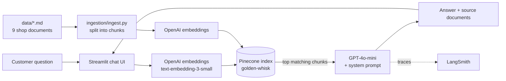
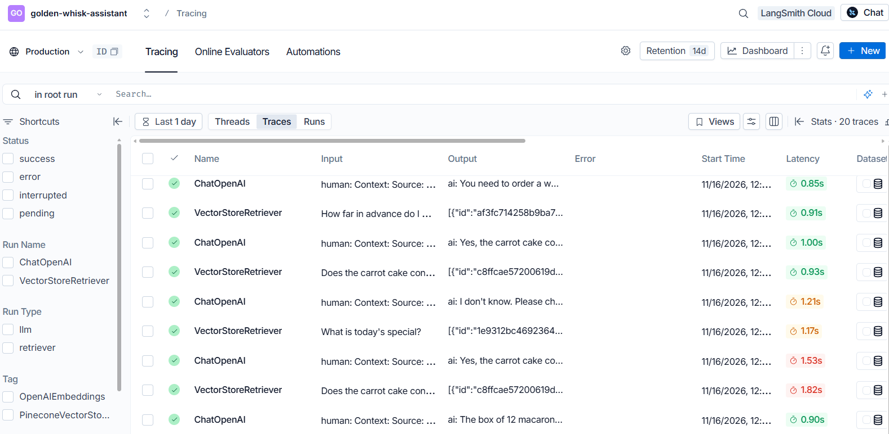

# 🥐 Golden Whisk Patisserie Assistant

A RAG (Retrieval-Augmented Generation) chatbot for a **fictional** French-style patisserie in Texas.
Customers can ask about the menu, prices, custom cake orders, allergens, hours, pickup, catering,
and seasonal pre-orders. The assistant answers **only** from the shop's own documents and says
"I don't know" when the answer is not there.

> **Note:** Golden Whisk Patisserie, its address, staff, menu, prices, and policies are invented
> for this portfolio project. Any resemblance to a real business is coincidental.

---

## ✨ Features

- **Answers grounded in documents** — 9 business documents (menu, allergens, custom cakes,
  hours, payments and refunds, storage, catering, FAQ) are split into chunks and stored in Pinecone.
- **Honest "I don't know"** — if the answer is not in the documents, the bot does not guess
  and points the customer to the shop's phone number or staff.
- **Allergen safety rule** — every answer about allergens or ingredients reminds the customer
  to confirm with a staff member, because all products are made in a shared kitchen.
- **Sources** — the app shows which document each answer came from.
- **Prompt-injection guard** — retrieved text is treated as untrusted data, not as instructions.
- **Observability** — every request is traced in **LangSmith** (retrieval step + LLM step, latency, inputs and outputs).
- **Always answers in English** — designed for US customers.

## 🧱 Architecture



## 📸 Screenshots

**Allergen question** — the answer comes from the allergen document and always adds a safety reminder:


**Orders and prices** — precise answers from the custom cake and menu documents:


**Question not covered by the documents** — the bot does not guess:


**LangSmith tracing** — each question is traced as a retrieval step and an LLM step:



## 🛠 Tech Stack

| Area | Tools |
|---|---|
| Language | Python 3.12 |
| LLM framework | LangChain |
| LLM / embeddings | OpenAI `gpt-4o-mini`, `text-embedding-3-small` |
| Vector database | Pinecone (serverless, AWS us-east-1, 1536 dims, cosine) |
| UI | Streamlit |
| Observability | LangSmith |
| Containers | Docker, Kubernetes *(in progress)* |

## 📁 Project Structure

```
golden-whisk-assistant/
├── app.py                  # Streamlit chat app (retrieval + answer + sources)
├── data/                   # 9 knowledge-base documents (Markdown)
├── ingestion/
│   ├── create_index.py     # creates the Pinecone index
│   ├── ingest.py           # loads, chunks, embeds and uploads documents
│   └── delete-index.py     # deletes the index
├── manifests/              # Kubernetes deployment and service
├── Dockerfile
├── requirements.txt
└── .env.example            # template for environment variables (no real keys)
```

## 🚀 Run Locally

1. Clone the repository and create a virtual environment:
   ```bash
   git clone https://github.com/katya-davydova/golden-whisk-assistant.git
   cd golden-whisk-assistant
   python -m venv .venv
   .venv\Scripts\activate        # Windows
   pip install -r requirements.txt
   ```
2. Create a `.env` file based on `.env.example` and add your own OpenAI, Pinecone
   (and optionally LangSmith) API keys. Set `PINECONE_INDEX_NAME=golden-whisk`.
3. Create the index and load the documents:
   ```bash
   python ingestion/create_index.py
   python ingestion/ingest.py
   ```
4. Start the chat:
   ```bash
   streamlit run app.py
   ```
   Open http://localhost:8501

## 💬 Example Questions

| Question | Expected behavior |
|---|---|
| How much is a box of 12 macarons? | $28 |
| How far in advance do I need to order a wedding cake? | 4 weeks |
| Does the carrot cake contain nuts? | Yes, walnuts — and a reminder to confirm with staff |
| What is today's special? | Doesn't know — check the board or ask staff |
| Do you have vegan desserts? | No vegan products at the moment |

## 👩‍💻 What I Built Myself

This project started from a RAG chatbot template from my Agentic AI course. My own work:

- **Domain and knowledge base** — designed the business and wrote 9 realistic documents,
  based on my real experience working in a patisserie.
- **System prompt** — turned a generic document assistant into a shop assistant with rules:
  no guessing, honest "I don't know" with a fallback contact, an allergen safety warning,
  short answers, English only.
- **Bug fix** — fixed the document path in `ingest.py` so the loader finds the `data/` folder.
- **New Pinecone index** for this project, separate from course data.
- **LangSmith tracing** to inspect retrieval results and latency for every question.
- **Security hygiene** — `.gitignore` and `.dockerignore` keep API keys out of Git and Docker images.
- **Manual testing** with expected answers (see the table above).

## 🗺 Roadmap

- [x] Knowledge base and RAG chatbot running locally
- [x] LangSmith tracing
- [x] Screenshots of the app and traces
- [ ] Docker image published to Docker Hub
- [ ] Automated evaluation with DeepEval (Faithfulness, Answer Relevancy, custom G-Eval allergen rule)
- [ ] Kubernetes deployment
- [ ] CI/CD with Jenkins
- [ ] Online demo
